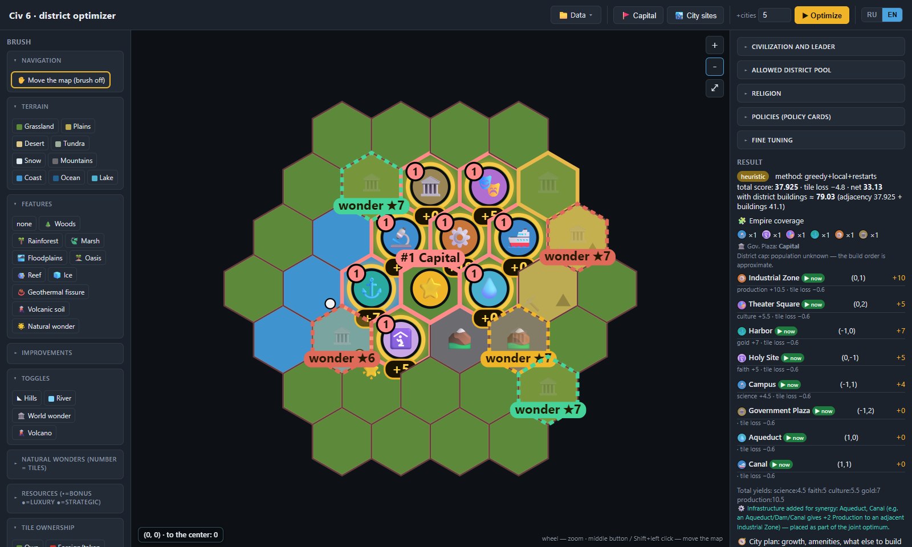
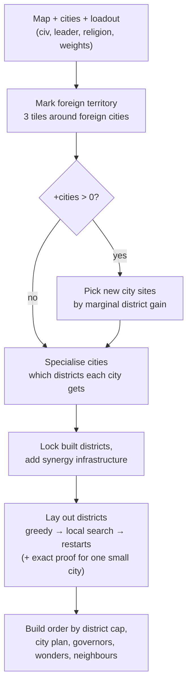

# Civ 6 District Optimizer

**English** · [Русский](README.ru.md)

[](https://github.com/Staery/civ6-optimizer/actions/workflows/ci.yml)
[](https://www.python.org)
[](https://fastapi.tiangolo.com)


[](LICENSE)

A tool for **Sid Meier's Civilization VI** that works out where to put districts and new cities.
Most adjacency calculators only show the bonus for a district you have already placed by hand.
This one searches for the best layout itself: it places the districts of **all your cities at once**,
uses bonuses between neighbouring cities, takes your civilization, leader, religion and policy cards
into account, and leaves rich tiles free to be worked.

The map comes **straight from your game** through a small Lua mod, or you can draw it in the built-in hex editor.
Everything runs locally: a Python server and a web page in your browser, with no account and no internet connection.
The interface is in **English and Russian** (switch in the top-right corner). The optimizer is plain Python with
no heavy dependencies and is covered by **127 tests**.

> **Game version.** Made and tested with **Civilization VI 1.0.12.54** (Steam build 15296837) with
> **Gathering Storm**, the **New Frontier Pass** and the **Leader Pass**. The rules follow Gathering Storm;
> *Rise and Fall* alone and the base game without expansions are not supported. See [Project status](#project-status).



<sub>The sample map after <b>▶ Optimize</b>: numbered district badges with their adjacency, wonder sites rated ★1–10, and the result panel with yields, tile loss and build order.</sub>

---

## Features

| | Feature | Where to look |
|---|---|---|
| 🧮 | **District layout for one city.** Greedy start, local search and random restarts. On small inputs an exact enumeration proves the result is optimal | `optimizer/single_city.py` |
| 🗺 | **Joint layout for the whole empire.** All cities are optimized on one board, so districts on a shared border boost each other | `optimizer/empire.py` |
| 🏙 | **New city sites, picked by the districts they enable.** Each candidate is scored by how much it improves the optimized layout, not just by how nice the land looks | `optimizer/empire_plan.py`, `optimizer/settle.py` |
| 🚩 | **Where to found the capital.** Checks the tiles your first Settler can reach in 1–3 turns and charges a penalty for each lost turn | `optimizer/settle.py` |
| 🎯 | **City specialisation.** Gives each city a role and a short district list for your victory type (base / secondary / once per empire), because building everything everywhere loses | `optimizer/specialize.py` |
| ⚖️ | **Opportunity cost.** Subtracts the food, production and gold a tile would give if a citizen worked it, so districts go on filler tiles. One slider sets the trade-off | `rules/tile_yields.py` |
| 🌐 | **Regional buildings.** Industrial Zone and Entertainment Complex / Water Park reach cities within 6 tiles, so they lean towards city borders | `optimizer/empire.py` |
| 🏛 | **Civs and leaders.** 51 civilizations and 75 leaders with their adjacency bonuses, unique districts (Seowon, Observatory, Acropolis, Hansa, Suguba) and a suggested victory focus | `rules/modifiers.py`, `rules/districts.py` |
| 🛐 | **Religion and policies.** 24 pantheons, 33 beliefs, 5 secret societies and adjacency policy cards, plus advice on which ones fit your actual land | `rules/modifiers.py`, `optimizer/advisor.py` |
| 🗿 | **World wonders.** 25 wonders with their placement rules: the best free tile, a backup tile, and the risk that the AI builds it first | `rules/wonders.py`, `optimizer/wonders.py` |
| 🌋 | **Natural wonders.** 22 natural wonders with their size in tiles, appeal and Holy Site adjacency | `rules/natural_wonders.py` |
| 🏠 | **Housing and amenities.** Growth state of each city, the best Neighborhood tile by appeal, and the luxury squeeze in wide empires | `optimizer/housing.py`, `optimizer/amenities.py`, `rules/appeal.py` |
| 👑 | **Governors.** Assigns each governor to the city that benefits most | `optimizer/governors.py` |
| ⚔️ | **Neighbours.** Rival civs nearby, the victory they tend to go for, loyalty pressure, and city-states worth sending envoys to | `optimizer/neighbors.py` |
| 📐 | **District cap and build order.** The (pop + 2) // 3 cap; the best tiles are still reserved for later districts | `rules/city_limits.py` |
| 🔄 | **Live import from the game.** A Lua mod writes the map to `Lua.log` every turn, and the web page can refresh itself every 12 seconds | `mod/Civ6MapExporter/`, `io/lualog_parser.py` |
| ✏️ | **Hex map editor.** Paint terrain, features, resources, rivers and wonders; zoom, pan, save and load JSON | `frontend/` |
| 🌍 | **English and Russian.** The whole interface and every server message; switch without reloading, the map and settings are kept | `frontend/i18n.js`, `backend/i18n.py` |

## How the optimizer works

Pressing **▶ Optimize** runs one pipeline on the server. Each step below names the module that does it.



### 1. The score of a layout

The optimizer maximises one number for the whole layout:

```text
score = Σ over districts   Σ over yields   weight(yield) × adjacency(district, tile, yield)
      − keep_tiles × Σ over used tiles   ( Σ weight(yield) × base_yield(tile) + 2 if the tile has a resource )
      + regional × Σ over Industrial Zones / Entertainment Complexes / Water Parks   min(cities within 6 tiles − 1, 4)
```

* **Adjacency** (`rules/adjacency.py`) is read from data tables in `rules/districts.py`. Each district has rules of
  three kinds: *per neighbour* (for example, a Campus gets +1 for every adjacent mountain), *presence* (a bonus
  if at least one neighbour matches) and *self* (a bonus for the tile itself, such as a river). On top of that:
  +0.5 for every adjacent district, +1 for an adjacent Government Plaza, and the extra bonuses of natural wonders.
* **Modifiers** from your civ, leader, pantheon, beliefs and policies are applied next: multipliers
  (Natural Philosophy doubles Campus adjacency), flat additions, per-neighbour terrain bonuses (Dance of the Aurora),
  river bonuses (Netherlands), mine bonuses (Gaul), appeal bonuses (Australia) and extra yield per adjacent
  district (Japan). Unique districts such as the Seowon or the Hansa replace the standard rules completely.
  Some beliefs add a second yield: with Work Ethic a Holy Site also gives Production equal to its adjacency.
* **Weights** come from the victory focus of your civ (or you set them by hand), so +2 Science and +2 Gold are not worth
  the same to a science player.
* Adjacency is kept as a **raw float**. The game shows the sum rounded down, but two +0.5 sources make +1, so the
  optimizer still values a half point that is not visible yet.
* **Opportunity cost** (`rules/tile_yields.py`) is the weighted Food/Production/Gold of the tile, plus 2 if it has a
  resource, times the **Keep good tiles** slider (default 0.3). At 0 districts cluster as tightly as possible;
  higher values keep floodplains, hills and resources free for citizens.
* **Regional overlap** (`optimizer/empire.py`) rewards an Industrial Zone or Entertainment Complex that also reaches other
  city centers within 6 tiles, because their Factory or Zoo buildings serve every city in range. Only extra cities
  count, up to 4.

Because every district gets +0.5 from its neighbours, the score of one district depends on where the others are.
You cannot place them one at a time and be done, so the optimizer searches over whole layouts.

### 2. Where each district may go

* A district can use tiles inside its city's work radius (3 tiles) that are empty and pass the district's placement
  rule: a Harbor needs a coast tile next to land, an Aqueduct must touch the City Center and fresh water or a mountain,
  a Seowon needs hills, Gaul cannot build next to the City Center, and so on (`rules/districts.py`).
* With several cities each tile belongs to the **nearest** own city center (`assign_territory`). Foreign tiles and a
  3-tile zone around foreign cities and city-states are excluded.
* In the empire search each district keeps only its **14 most promising tiles**, ranked by raw adjacency + 0.5 per
  free land neighbour (room for future neighbours). This keeps big empires fast without losing good options.

### 3. Searching for the best layout

`optimizer/single_city.py` and `optimizer/empire.py` use the same three steps:

1. **Greedy construction.** Districts with the fewest legal tiles go first. Each takes the tile that gives the best
   total score together with the districts already placed.
2. **Local search.** Two kinds of moves are repeated until neither improves the score: move one district to a free
   legal tile, or swap the tiles of two districts. The first improving move is taken each time.
3. **Random restarts.** Random valid layouts are improved by the same local search, and the best result wins
   (24 restarts for one city, 14 for an empire; fewer when there are more than 14 districts to place). The random seed
   is fixed, so the same map always gives the same answer.

For **one city**, if the number of possible layouts (the product of each district's tile count) is at most 1.5 million,
the optimizer then **enumerates every layout**. If the enumeration finishes, the result is marked
*proven optimal*; otherwise it is marked *heuristic*. Tests check that the heuristic finds the same optimum on small maps.

For an **empire**, cities whose centers are more than 7 tiles apart cannot have adjacent districts, so they are split into
independent clusters (union-find) and each cluster is solved separately. This keeps planning fast with 20+ cities.

### 4. Choosing sites for new cities

When **+cities** is above 0, `optimizer/empire_plan.py` picks the sites before the districts are laid out:

1. **Candidates.** Every land tile at least 4 tiles from any city (yours or foreign) and at most 9 tiles from your empire
   is scored by the settle model (`optimizer/settle.py`). The best well-spaced candidates form a pool of
   max(14, cities wanted + 8).
2. **Settle score.** Tiles in rings 1/2/3 count with weights 1.0/0.7/0.45. Fresh water adds 4, coast 1.5; a dry site with
   no way to build an Aqueduct loses 3. District potential adds 1.2 per mountain, 0.4 per river tile (up to 3),
   0.25 per wood, 0.5 per sea resource and 0.3 per hill or mine. Each distinct luxury adds 0.6 and each strategic
   resource 0.7 (up to 4 each); a hill center adds 0.8. Floodplains without a river for a Dam, volcanoes next to the
   site and loyalty pressure from strong foreign cities subtract points, and so does every tile beyond 5 from your
   nearest city (−0.9 each). Civ abilities adjust the score (the Inca like mountains, Russia likes tundra, and so on).
3. **Marginal gain.** For each candidate the district optimizer runs twice on the local cluster (the nearby existing
   cities), once without the new city and once with it, in a fast mode. The difference is the
   **district gain** of that site, including the bonuses it gives to and gets from neighbouring districts.
4. **Greedy selection.** The site with the best `district gain + 0.4 × settle score` is added, the cluster is updated,
   and the step repeats until the requested number of cities is reached or no site adds value.

### 5. City specialisation

Building every district in every city wastes production, and the district cap limits a city to (pop + 2) // 3 of them.
`optimizer/specialize.py` hands out districts like a pyramid, among the types you allowed:

* **Every city:** a Harbor if it is coastal, otherwise a Commercial Hub, plus the main district of your victory type
  (Campus for science, Theater Square for culture, and so on).
* **Production cities:** the top ~40% of cities by Industrial Zone potential get an Industrial Zone instead of the main
  district (the capital gets both). With Abraham Lincoln or Victoria (Age of Steam) every city gets one.
* **Secondary districts** (Holy Site, Theater Square, Encampment, Preserve…) go to the best ~30% of cities.
  "Best" means the highest adjacency the district can reach in that city, minus a penalty for cities that already
  have many districts, so roles spread across the empire.
* **Amenities:** an Entertainment Complex (or Water Park) in about one city in three or four, largest cities first.
* **Once per empire:** the Government Plaza in the strongest production city, the Diplomatic Quarter in the capital,
  and a Spaceport for a science victory.
* **Coverage:** the empire gets at least one of each key district somewhere.

Districts you have already built are kept and count towards these quotas. When an Industrial Zone is planned, an Aqueduct,
Dam or Canal is added to the search if there is a legal tile for it, because each gives the Industrial Zone +2.

### 6. After the layout

* **Build order** (`rules/city_limits.py`): districts are sorted by score. The first (pop + 2) // 3 of them are marked
  *▶ now*, the rest *⏳ later* with the population they need. Aqueducts, Neighborhoods, Canals, Dams and Spaceports do not
  count towards the cap.
* **City plan:** Housing and Amenity estimates for each city, plus extra districts on concrete tiles: an Entertainment
  Complex for an Amenity deficit, an Aqueduct and a Neighborhood (on the highest-appeal tile) when Housing is short,
  a Dam for floodplains, a Preserve on Charming tiles.
* **Governors** are assigned one-to-one by scoring every governor–city pair. **World wonders** take the best legal free
  tile inside your borders, ranked by value, with a backup tile and the risk that the AI builds them first.
  **Neighbours** gives advice about rivals and city-states within 12 tiles.

## Requirements

* **Windows 10/11.** The optimizer itself is cross-platform; the launch scripts and live import from the game assume Windows.
* **Python 3.11 or newer** ([python.org](https://www.python.org/downloads/); tick *Add python.exe to PATH* during setup).
* A modern browser (Chrome, Edge, Firefox).
* *For importing a game:* Civilization VI **1.0.12.54** or newer with **Gathering Storm**. Content of the **New Frontier Pass** and
  the **Leader Pass** is supported too.

## Installation

### 1. Get the code

```powershell
git clone https://github.com/Staery/civ6-optimizer.git
cd civ6-optimizer
```

Or download the ZIP (**Code → Download ZIP**) and unpack it anywhere.

### 2a. One-click start (Windows)

Double-click **`start.bat`**. On the first run it installs the dependencies (FastAPI and Uvicorn),
then starts the server and opens <http://127.0.0.1:8000> in your browser. If the server is already
running, it just opens the browser. **`stop.bat`** shuts the server down.

### 2b. Manual start (any OS)

```bash
python -m venv .venv
# Windows: .venv\Scripts\activate    Linux/macOS: source .venv/bin/activate
pip install -e .
python -m uvicorn backend.app:app --host 127.0.0.1 --port 8000
```

Then open <http://127.0.0.1:8000>.

*Optional:* `pip install -e ".[solver]"` installs OR-Tools. The built-in optimizer does not need it.

### 3. Connect the game (optional, recommended)

To import your real map you need to install the **Map Exporter** mod and turn on Lua logging once.
In short:

1. Copy `mod/Civ6MapExporter` to `Documents\My Games\Sid Meier's Civilization VI\Mods\`.
2. In `Documents\My Games\Sid Meier's Civilization VI\AppOptions.txt` set `EnableLuaDebugLibrary 1`.
3. In the game, open **Additional Content → Mods**, enable **Civ6 Optimizer - Map Exporter**, and start or load a game.
4. In the optimizer, click **📁 Data → 🔄 From game (live)**.

📖 **Step-by-step guide with a copy script, a FireTuner fallback and troubleshooting: [mod/INSTALL.md](mod/INSTALL.md).**

The mod only reads the map. It does not change gameplay, does not affect saves and is not needed to load them later.

## Usage

### Typical turn

1. **Get a map.** Import from the game, or load the sample (**📁 Data → Load sample**), or draw one.
2. **Pick your civ and leader** in *Civilization and leader*, then click **🎯 Apply victory focus** to set the
   yield weights and the district pool for your victory type.
3. Set the number of new cities in **+cities**; 0 only optimizes the cities you already have.
4. Click **▶ Optimize**. The map shows a badge with the adjacency for each planned district, the proposed city
   sites and the wonder sites. The right panel shows the full plan, city by city.
5. Build the districts that are marked **▶ now**. The others are reserved tiles for when the district cap allows them.

At the very start of a game, put the Settler on the map and click **🚩 Capital** to see where the capital should go.

### Settings worth knowing

| Setting | What it does |
|---|---|
| **Keep good tiles** | How much to protect valuable tiles. Lower — districts cluster tightly and boost each other; higher — resources, floodplains and hills stay free. Default 0.3 |
| **Regional overlap** | How much to favour an Industrial Zone / Entertainment Complex that covers several cities |
| **First city: turn penalty** | How much each turn of moving the Settler costs. Higher — more willing to settle in place |
| **Allowed district pool** | District types the optimizer may use at all |
| **🏙️ City sites** | Quick list of good city sites without a district layout |
| **auto-refresh** | Re-read `Lua.log` every 12 seconds while you play |
| **RU / EN** | Interface language. The choice is remembered; by default it follows the browser language |

Editor controls: left click paints (you can drag), right click erases to grassland, the mouse wheel zooms,
and the middle button or Shift + left click pans.

## Rules and accuracy

* **Ruleset:** Gathering Storm + New Frontier Pass. Major adjacency = +2, standard = +1, minor = +0.5; the game
  shows the sum rounded down.
* Adjacency numbers have been checked against community sources and are covered by tests (`tests/test_adjacency.py`).
  A few disputed values are marked **`VALIDATE:`** in the code (9 places) and are easy to fix because the rules are data.
* Building yields, housing and amenities are **planning estimates**. They help you rank options; they are not exact in-game numbers.
* **Mods:** Workshop mods that do not change district adjacency (UI mods such as CQUI, Better Balanced Starts,
  YnAMP maps, AI mods and so on) work fine; with the mod they are picked up through the imported map. Mods that change adjacency
  rules are not modelled. Very large maps are clipped to 14 tiles around your cities in the editor.

## Project layout

```text
.
├── backend/
│   ├── app.py               # FastAPI: REST API and the static web page
│   ├── i18n.py              # response language (X-Lang header), RU → EN translation
│   ├── locales/en.json      # English catalogue for every server string
│   ├── domain/              # hexgrid.py (axial hex math), models.py (tiles, cities, districts)
│   ├── rules/               # pure data and formulas
│   │   ├── districts.py     #   districts, adjacency sources, placement rules, unique districts
│   │   ├── adjacency.py     #   adjacency evaluation for a district on a tile
│   │   ├── modifiers.py     #   civs, leaders, pantheons, beliefs, policies, governors, victory focus
│   │   ├── wonders.py  natural_wonders.py  tile_yields.py  appeal.py  buildings.py  city_limits.py
│   ├── optimizer/
│   │   ├── single_city.py   #   greedy + local search + restarts, exact enumeration on small inputs
│   │   ├── empire.py        #   joint multi-city layout, clusters, regional overlap
│   │   ├── empire_plan.py   #   choosing new city sites by marginal district value
│   │   ├── settle.py  specialize.py  wonders.py  advisor.py
│   │   └── housing.py  amenities.py  governors.py  neighbors.py
│   └── io/                  # lualog_parser.py (game import), map_schema.py (map JSON)
├── frontend/                # index.html, i18n.js, app.js, style.css: Canvas hex editor, no build step
├── mod/Civ6MapExporter/     # the in-game exporter mod (Lua) and install guides
├── data/sample_map.json     # sample map
├── scripts/                 # smoke test, sample builders, dev/live server scripts (PowerShell)
├── tests/                   # pytest suite
├── start.bat / stop.bat     # one-click start and stop on Windows
└── pyproject.toml
```

## API

The web page uses a small JSON API, and you can call it directly. Interactive docs are at
<http://127.0.0.1:8000/docs> while the server is running. Send `X-Lang: en` (or `?lang=en`) to get
names, notes and advice in English; the default is Russian.

| Method | Path | Purpose |
|---|---|---|
| `GET` | `/api/meta` | Catalogues for the UI: districts, civs, leaders, beliefs, policies, wonders |
| `GET` | `/api/sample` | The sample map |
| `POST` | `/api/optimize` | District layout for one city or the whole empire |
| `POST` | `/api/plan-empire` | New city sites + district layout for old and new cities |
| `POST` | `/api/suggest-cities` | Ranked city sites |
| `POST` | `/api/first-city` | Capital site near the Settler |
| `POST` | `/api/suggest-wonders` | Best tiles for world wonders, with AI risk |
| `POST` | `/api/housing`, `/api/amenities` | Growth and amenity estimates per city |
| `GET` | `/api/import-latest` | Read `Lua.log` from its default path (or `?path=`) |
| `POST` | `/api/import-lualog` | Parse the `Lua.log` text sent in the request body |

The map format (axial `q`/`r` tiles and cities) is described in `backend/io/map_schema.py`.

## Testing

```bash
pip install -e ".[dev]"
pytest                       # 127 tests, about 30 seconds
python scripts/smoke_test.py # calls every API endpoint in-process
```

* **Unit tests** cover hex math, adjacency for each district, civ and leader modifiers, natural wonders,
  tile yields, the district cap, housing and amenities, and the `Lua.log` parser.
* **Optimizer tests** check that the heuristic matches the exact enumeration on small maps, and test
  cross-city packing, city sites, the first city and wonder placement.
* **Translation tests** check that every Russian string in the server and the web page has an English version,
  and run all endpoints in English on a varied map to make sure no Russian text is left in the answers.
* **The smoke test** imports the real FastAPI handlers and calls each endpoint, which catches wiring and
  serialisation errors that unit tests miss.

The same checks run in GitHub Actions on Python 3.11, 3.12 and 3.13 (`.github/workflows/ci.yml`).

For development on Windows there is a two-server setup: a dev server on port 8001 with auto-reload, a gate
script (tests + smoke) and a live server on port 8000. See [scripts/README_TESTING.md](scripts/README_TESTING.md) (in Russian).

## Project status

Version 0.1: the tool is used in real games and covers the whole planning loop. The rules are written for
**Civilization VI 1.0.12.54** (Gathering Storm + New Frontier Pass + Leader Pass); a later game patch that changes
adjacency numbers needs a matching change in `backend/rules/`.

### Done

- [x] Adjacency engine for all districts, unique districts and their special rules (Seowon, Hansa, Observatory, Acropolis…)
- [x] District layout for one city with a proof of optimality on small inputs
- [x] Joint layout for the whole empire, regional overlap of Factories and Zoos
- [x] New city sites chosen by the districts they enable; capital site from the first Settler
- [x] City specialisation by victory type, district cap and build order
- [x] 51 civilizations and 75 leaders (base game, expansions, New Frontier Pass, Leader Pass personas), pantheons, beliefs, secret societies, adjacency policy cards
- [x] World and natural wonders, housing and amenities, governors, neighbours and city-states
- [x] In-game map exporter mod, live import every turn, FireTuner fallback
- [x] Hex map editor, JSON save/load
- [x] English and Russian interface and API
- [x] Tests (127) and an API smoke test; CI on GitHub Actions

### Not done yet / known gaps

- [ ] Nine disputed adjacency values marked `VALIDATE:` in the code still need checking against the game
- [ ] Tile improvements and the order of builders' work are not planned (only districts)
- [ ] Buildings, great people and most wonders are approximate yields; policy cards that do not change adjacency are not modelled
- [ ] Policy cards added by mods (e.g. *Extended Policy Cards*) are not modelled
- [ ] Only small single-city layouts are proven optimal; empires and large cities use a heuristic
- [ ] Maps from mods with custom terrain or features produce `warnings` on import
- [ ] The UI is a desktop page: no layout for phones

### Plans

- Check every `VALIDATE:` value in the game and remove the markers
- Optional exact solver (OR-Tools CP-SAT, already an optional dependency) for larger single-city and cluster layouts
- Plan tile improvements together with districts (farms for Neighborhood appeal, mines for Gaul and Hansa, and so on)
- Show the plan inside the game as map pins, so you do not need to switch to the browser
- Model more policy cards, including popular policy mods
- A downloadable build with Python included, like the TF3 Planner

## License

[MIT](LICENSE) © 2026 Staery

*Civilization VI is a trademark of Take-Two Interactive Software. This is a fan project and is not affiliated with Firaxis Games or 2K.*
