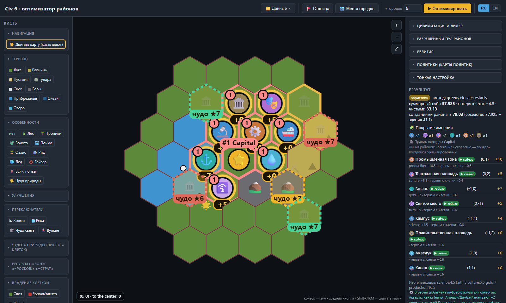
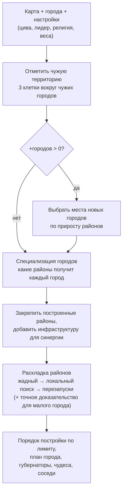

# Civ 6 District Optimizer

[English](README.md) · **Русский**

[](https://github.com/Staery/civ6-optimizer/actions/workflows/ci.yml)
[](https://www.python.org)
[](https://fastapi.tiangolo.com)


[](LICENSE)

Инструмент для **Sid Meier's Civilization VI**, который вычисляет, где ставить районы и новые города.
Обычные калькуляторы соседства лишь показывают бонус района, который ты уже поставил вручную.
Этот ищет лучшую раскладку сам: размещает районы **всех городов сразу**, использует бонусы на стыке
соседних городов, учитывает цивилизацию, лидера, религию и карты политик и оставляет ценные клетки
под обработку.

Карта берётся **прямо из партии** через небольшой Lua-мод, а можно нарисовать её во встроенном
редакторе гексов. Всё работает локально: Python-сервер и веб-страница в браузере, без аккаунтов
и без интернета. Интерфейс — **на русском и английском** (переключатель в правом верхнем углу).
Оптимизатор написан на чистом Python без тяжёлых зависимостей и покрыт **127 тестами**.

> **Версия игры.** Сделано и проверено на **Civilization VI 1.0.12.54** (сборка Steam 15296837) с
> **Gathering Storm**, **New Frontier Pass** и **Leader Pass**. Правила — по Gathering Storm; только
> *Rise and Fall* и базовая игра без дополнений не поддерживаются. См. [Состояние проекта](#состояние-проекта).



<sub>Пример карты после <b>▶ Оптимизировать</b>: номерные значки районов с бонусом соседства, места под чудеса с оценкой ★1–10 и панель результата с выходами, потерями клеток и порядком постройки.</sub>

---

## Возможности

| | Возможность | Где смотреть |
|---|---|---|
| 🧮 | **Раскладка районов одного города.** Жадный старт, локальный поиск и случайные перезапуски. На небольших картах точный перебор доказывает, что решение оптимально | `optimizer/single_city.py` |
| 🗺 | **Совместная раскладка всей империи.** Все города оптимизируются на одной доске, поэтому районы на общей границе усиливают друг друга | `optimizer/empire.py` |
| 🏙 | **Места под новые города — по районам, которые они дают.** Кандидат оценивается по тому, насколько он улучшает оптимальную раскладку, а не только по качеству земли | `optimizer/empire_plan.py`, `optimizer/settle.py` |
| 🚩 | **Где основать столицу.** Перебирает клетки, до которых первый Поселенец дойдёт за 1–3 хода, со штрафом за каждый потерянный ход | `optimizer/settle.py` |
| 🎯 | **Специализация городов.** Каждому городу — роль и короткий список районов под выбранную победу (базовые / второстепенные / один на империю): строить всё везде невыгодно | `optimizer/specialize.py` |
| ⚖️ | **Цена клетки.** Из оценки вычитается еда, производство и золото, которые клетка дала бы при обработке, поэтому районы встают на пустые клетки. Компромисс задаётся одним ползунком | `rules/tile_yields.py` |
| 🌐 | **Региональные здания.** Промзона и Парк развлечений / Аквапарк действуют на города в радиусе 6, поэтому их выгодно ставить на стыке | `optimizer/empire.py` |
| 🏛 | **Цивилизации и лидеры.** 51 цивилизация и 75 лидеров с их бонусами соседства, уникальные районы (Совон, Обсерватория, Акрополь, Ганза, Сугуба) и рекомендуемый тип победы | `rules/modifiers.py`, `rules/districts.py` |
| 🛐 | **Религия и политики.** 24 пантеона, 33 верования, 5 тайных обществ и карты политик на соседство — плюс совет, что подходит именно твоей земле | `rules/modifiers.py`, `optimizer/advisor.py` |
| 🗿 | **Чудеса света.** 25 чудес с условиями размещения: лучшая свободная клетка, запасная и риск, что ИИ построит его раньше | `rules/wonders.py`, `optimizer/wonders.py` |
| 🌋 | **Чудеса природы.** 22 чуда природы с размером в клетках, привлекательностью и бонусом Святому месту | `rules/natural_wonders.py` |
| 🏠 | **Жильё и довольство.** Состояние роста каждого города, лучшая клетка под Пригород по привлекательности и нехватка роскоши в широкой империи | `optimizer/housing.py`, `optimizer/amenities.py`, `rules/appeal.py` |
| 👑 | **Губернаторы.** Назначает каждого губернатора в город, где от него больше всего пользы | `optimizer/governors.py` |
| ⚔️ | **Соседи.** Какие соперники рядом, к какой победе они склонны, давление лояльности и города-государства, куда стоит слать послов | `optimizer/neighbors.py` |
| 📐 | **Лимит районов и порядок постройки.** Лимит (население + 2) // 3; лучшие клетки всё равно резервируются под будущие районы | `rules/city_limits.py` |
| 🔄 | **Живой импорт из игры.** Lua-мод пишет карту в `Lua.log` каждый ход, а страница может обновляться сама раз в 12 секунд | `mod/Civ6MapExporter/`, `io/lualog_parser.py` |
| ✏️ | **Редактор карты.** Террейн, особенности, ресурсы, реки, чудеса; зум, панорама, сохранение и загрузка JSON | `frontend/` |
| 🌍 | **Русский и английский.** Весь интерфейс и все сообщения сервера; язык переключается без перезагрузки, карта и настройки сохраняются | `frontend/i18n.js`, `backend/i18n.py` |

## Как работает оптимизатор

Кнопка **▶ Оптимизировать** запускает на сервере один конвейер. У каждого шага ниже указан модуль, который его выполняет.



### 1. Оценка раскладки

Оптимизатор максимизирует одно число для всей раскладки:

```text
оценка = Σ по районам   Σ по выходам   вес(выход) × соседство(район, клетка, выход)
       − беречь_клетки × Σ по занятым клеткам   ( Σ вес(выход) × базовый_выход(клетка) + 2, если на клетке ресурс )
       + перекрытие × Σ по Промзонам / Паркам развлечений / Аквапаркам   min(городов в радиусе 6 − 1, 4)
```

* **Соседство** (`rules/adjacency.py`) считается по таблицам из `rules/districts.py`. У каждого района есть
  правила трёх видов: *за каждого соседа* (например, Кампус получает +1 за каждую соседнюю гору), *за наличие*
  (бонус, если подходит хотя бы один сосед) и *за саму клетку* (например, река). Сверху добавляется +0.5 за
  каждый соседний район, +1 за соседнюю Правительственную площадь и особые бонусы чудес природы.
* Затем применяются **модификаторы** цивилизации, лидера, пантеона, верований и политик: множители
  (Natural Philosophy удваивает соседство Кампуса), плоские прибавки, бонусы за соседний террейн (Танец Авроры),
  за реку (Нидерланды), за шахты (Галлия), за привлекательность (Австралия) и дополнительный выход за каждый
  соседний район (Япония). Уникальные районы вроде Совона или Ганзы полностью заменяют стандартные правила.
  Некоторые верования добавляют второй выход: с Трудовой дисциплиной Святое место даёт ещё и производство,
  равное своему соседству.
* **Веса** берутся из фокуса победы цивилизации (или задаются вручную), поэтому +2 науки и +2 золота для
  научного игрока стоят по-разному.
* Соседство хранится **дробным числом**. Игра показывает сумму, округлённую вниз, но два источника по +0.5 дают +1,
  поэтому оптимизатор ценит и пока «невидимые» полбалла.
* **Цена клетки** (`rules/tile_yields.py`) — взвешенные еда, производство и золото клетки плюс 2, если на ней ресурс,
  умноженные на ползунок **Беречь хорошие клетки** (по умолчанию 0.3). При 0 районы кучкуются максимально плотно,
  при больших значениях поймы, холмы и ресурсы остаются под обработку.
* **Региональное перекрытие** (`optimizer/empire.py`) поощряет Промзону или Парк развлечений, которые накрывают
  центры других городов в радиусе 6: их Фабрика или Зоопарк работают на все города в этом радиусе. Считаются
  только дополнительные города, не больше 4.

Каждый район получает +0.5 от соседних районов, поэтому оценка одного района зависит от того, где стоят
остальные. Расставить районы по одному и на этом закончить нельзя, поэтому оптимизатор ищет по раскладкам целиком.

### 2. Куда можно ставить район

* Район может занять клетку в радиусе обработки своего города (3 клетки), если она свободна и проходит правило
  размещения: Гавань — на прибрежной клетке рядом с сушей, Акведук — вплотную к центру города и к пресной воде
  или горе, Совон — на холме, Галлия не строит вплотную к центру города и т. д. (`rules/districts.py`).
* Если городов несколько, каждая клетка достаётся **ближайшему** своему городу (`assign_territory`). Чужие клетки
  и зона в 3 клетки вокруг чужих городов и городов-государств исключаются.
* В поиске по империи у каждого района остаются только **14 самых перспективных клеток** — по базовому соседству
  плюс 0.5 за каждого свободного сухопутного соседа (место под будущие районы). Так большие империи считаются быстро,
  а хорошие варианты не теряются.

### 3. Поиск лучшей раскладки

`optimizer/single_city.py` и `optimizer/empire.py` работают в три шага:

1. **Жадное построение.** Первыми ставятся районы, у которых меньше всего допустимых клеток. Каждый занимает
   клетку, которая даёт лучшую общую оценку вместе с уже поставленными районами.
2. **Локальный поиск.** Повторяются два вида ходов, пока ни один не улучшает оценку: перенести один район на
   свободную допустимую клетку или поменять местами клетки двух районов. Каждый раз берётся первый улучшающий ход.
3. **Случайные перезапуски.** Случайные допустимые раскладки улучшаются тем же локальным поиском, побеждает лучшая
   (24 перезапуска для одного города, 14 для империи; меньше, если районов больше 14). Зерно генератора фиксировано,
   поэтому одна и та же карта всегда даёт один и тот же ответ.

Для **одного города**, если число возможных раскладок (произведение числа клеток каждого района) не больше
1,5 миллиона, оптимизатор затем **перебирает все раскладки**. Если перебор завершился, результат помечается как
*оптимум доказан*, иначе — *эвристика*. Тесты проверяют, что эвристика находит тот же оптимум на малых картах.

В **империи** города, центры которых дальше 7 клеток друг от друга, не могут иметь соседних районов, поэтому они
делятся на независимые кластеры (union-find), и каждый кластер решается отдельно. Так планирование остаётся быстрым
и при 20+ городах.

### 4. Выбор мест под новые города

Если **+городов** больше 0, `optimizer/empire_plan.py` выбирает места до раскладки районов:

1. **Кандидаты.** Каждая клетка суши не ближе 4 клеток к любому городу (своему или чужому) и не дальше 9 клеток от
   империи оценивается моделью заселения (`optimizer/settle.py`). Лучшие кандидаты с нужным разносом образуют
   пул размером max(14, нужное число городов + 8).
2. **Оценка места.** Клетки на расстоянии 1/2/3 входят с весами 1.0/0.7/0.45. Пресная вода даёт +4, побережье +1.5;
   сухое место, где нельзя построить Акведук, теряет 3. Потенциал районов: +1.2 за гору, +0.4 за речную клетку
   (до 3), +0.25 за лес, +0.5 за морской ресурс, +0.3 за холм или шахту. Каждая новая роскошь даёт +0.6,
   каждый стратегический ресурс +0.7 (до 4 каждого); центр на холме — +0.8. Поймы без реки под Дамбу, вулкан рядом
   и давление лояльности сильных чужих городов отнимают очки, как и каждая клетка дальше 5 от ближайшего твоего
   города (−0.9 за каждую). Способности цивилизаций правят оценку (инки любят горы, Россия — тундру и т. д.).
3. **Прирост.** Для каждого кандидата оптимизатор районов дважды прогоняет локальный кластер (ближайшие
   существующие города) в быстром режиме: без нового города и с ним. Разница — **прирост районов** этого места,
   включая бонусы, которые он даёт соседним районам и получает от них.
4. **Жадный выбор.** Добавляется место с лучшим `прирост районов + 0.4 × оценка места`, кластер обновляется,
   и шаг повторяется, пока не набрано нужное число городов или пока места перестают что-то добавлять.

### 5. Специализация городов

Строить все районы в каждом городе — пустая трата производства, а лимит позволяет городу не больше
(население + 2) // 3 районов. `optimizer/specialize.py` раздаёт районы «пирамидой» среди разрешённых типов:

* **В каждом городе:** Гавань, если город прибрежный, иначе Центр коммерции, плюс основной район твоей победы
  (Кампус для научной, Театральная площадь для культурной и т. д.).
* **Производственные города:** ~40% лучших по потенциалу Промзоны получают Промзону вместо основного района
  (столица — оба). С Авраамом Линкольном или Викторией «Эпоха пара» Промзона ставится в каждом городе.
* **Второстепенные районы** (Святое место, Театральная площадь, Военный лагерь, Заповедник…) — лучшим ~30% городов.
  «Лучший» — это максимальное соседство, которое район может получить в этом городе, со штрафом для городов,
  где районов уже много, чтобы роли распределялись по империи.
* **Довольство:** Парк развлечений (или Аквапарк) примерно в каждом третьем-четвёртом городе, начиная с крупных.
* **Один на империю:** Правительственная площадь — в сильнейшем производственном городе, Дипломатический квартал —
  в столице, Космопорт — для научной победы.
* **Покрытие:** в империи обязательно есть хотя бы по одному ключевому району.

Уже построенные районы сохраняются и засчитываются в эти квоты. Если запланирована Промзона, в поиск добавляются
Акведук, Дамба или Канал (когда для них есть клетка): каждый из них даёт Промзоне +2.

### 6. После раскладки

* **Порядок постройки** (`rules/city_limits.py`): районы сортируются по оценке. Первые (население + 2) // 3 помечаются
  *▶ сейчас*, остальные — *⏳ позже* с нужным населением. Акведуки, Пригороды, Каналы, Дамбы и Космопорты в лимит
  не входят.
* **План города:** оценка жилья и довольства по каждому городу и дополнительные районы на конкретных клетках:
  Парк развлечений при нехватке довольства, Акведук и Пригород (на самой привлекательной клетке) при нехватке жилья,
  Дамба для пойм, Заповедник на очаровательных клетках.
* **Губернаторы** назначаются один к одному по оценке каждой пары «губернатор — город». **Чудеса света** получают
  лучшую свободную допустимую клетку в твоих границах с ранжированием по ценности, запасной клеткой и риском, что
  ИИ построит их раньше. **Соседи** — советы по соперникам и городам-государствам в радиусе 12 клеток.

## Что нужно

* **Windows 10/11.** Сам оптимизатор кроссплатформенный, но скрипты запуска и живой импорт из игры рассчитаны на Windows.
* **Python 3.11 или новее** ([python.org](https://www.python.org/downloads/); при установке отметь *Add python.exe to PATH*).
* Современный браузер (Chrome, Edge, Firefox).
* *Для импорта партии:* Civilization VI **1.0.12.54** или новее с дополнением **Gathering Storm**. Контент **New Frontier Pass**
  и **Leader Pass** тоже поддерживается.

## Установка

### 1. Скачать код

```powershell
git clone https://github.com/Staery/civ6-optimizer.git
cd civ6-optimizer
```

Или скачай ZIP (**Code → Download ZIP**) и распакуй в любую папку.

### 2а. Запуск в один клик (Windows)

Запусти **`start.bat`** двойным щелчком. При первом запуске он сам поставит зависимости (FastAPI
и Uvicorn), поднимет сервер и откроет <http://127.0.0.1:8000> в браузере. Если сервер уже запущен,
просто откроет браузер. **`stop.bat`** выключает сервер.

### 2б. Запуск вручную (любая ОС)

```bash
python -m venv .venv
# Windows: .venv\Scripts\activate    Linux/macOS: source .venv/bin/activate
pip install -e .
python -m uvicorn backend.app:app --host 127.0.0.1 --port 8000
```

Затем открой <http://127.0.0.1:8000>.

*Необязательно:* `pip install -e ".[solver]"` ставит OR-Tools. Встроенному оптимизатору он не нужен.

### 3. Подключить игру (необязательно, но рекомендуется)

Чтобы импортировать настоящую карту, нужно поставить мод **Map Exporter** и один раз включить логирование Lua.
Коротко:

1. Скопируй `mod/Civ6MapExporter` в `Документы\My Games\Sid Meier's Civilization VI\Mods\`.
2. В `Документы\My Games\Sid Meier's Civilization VI\AppOptions.txt` поставь `EnableLuaDebugLibrary 1`.
3. В игре открой **Дополнения → Моды**, включи **Civ6 Optimizer - Map Exporter** и начни или загрузи партию.
4. В оптимизаторе нажми **📁 Данные → 🔄 Из игры (live)**.

📖 **Пошаговая инструкция со скриптом копирования, запасным способом через FireTuner и решением проблем: [mod/INSTALL_RU.md](mod/INSTALL_RU.md).**

Мод только читает карту: на геймплей не влияет, в сохранения не попадает, и для загрузки сейвов потом не нужен.

## Как пользоваться

### Обычный ход

1. **Загрузи карту.** Импорт из игры, пример (**📁 Данные → Загрузить пример**) или нарисуй сам.
2. **Выбери цивилизацию и лидера** в разделе *Цивилизация и лидер* и нажми **🎯 Применить фокус победы** —
   выставятся веса выходов и набор районов под твой тип победы.
3. Укажи число новых городов в поле **+городов**; 0 — оптимизировать только существующие.
4. Нажми **▶ Оптимизировать**. На карте появятся значки запланированных районов с бонусом соседства,
   предложенные места городов и места под чудеса; справа — полный план по городам.
5. Строй районы с пометкой **▶ сейчас**. Остальные — зарезервированные клетки на потом, когда позволит лимит районов.

В самом начале партии поставь Поселенца на карту и нажми **🚩 Столица** — покажет, где лучше основать столицу.

### Настройки, которые стоит знать

| Настройка | Что делает |
|---|---|
| **Беречь хорошие клетки** | Насколько беречь ценные клетки под обработку. Меньше — районы плотнее кучкуются и усиливают друг друга, больше — оставляют ресурсы, поймы и холмы свободными. По умолчанию 0.3 |
| **Региональное перекрытие** | Насколько охотно ставить Промзону и Парк развлечений / Аквапарк так, чтобы они накрывали несколько городов |
| **Первый город: штраф за ход** | Сколько «стоит» каждый ход переезда Поселенца. Больше — охотнее селиться на месте |
| **Разрешённый пул районов** | Какие типы районов оптимизатор вообще может использовать |
| **🏙️ Места городов** | Быстрый список хороших мест под города без раскладки районов |
| **авто-обновление** | Перечитывать `Lua.log` каждые 12 секунд, пока идёт партия |
| **RU / EN** | Язык интерфейса. Выбор запоминается; по умолчанию берётся язык браузера |

Управление редактором: ЛКМ — рисовать (можно тянуть), ПКМ — стереть в луга, колесо — зум,
средняя кнопка или Shift + ЛКМ — двигать карту.

## Правила и точность

* **Набор правил:** Gathering Storm + New Frontier Pass. Крупный бонус соседства = +2, обычный = +1,
  малый = +0.5; игра показывает сумму, округлённую вниз.
* Числа соседства сверены с источниками сообщества и покрыты тестами (`tests/test_adjacency.py`).
  Несколько спорных значений помечены в коде как **`VALIDATE:`** (9 мест) — их легко поправить, потому что правила — это данные.
* Выходы зданий, жильё и довольство — **оценки для планирования**. Они помогают сравнивать варианты, но не равны точным цифрам в игре.
* **Моды:** моды из Workshop, которые не меняют соседство районов (интерфейс вроде CQUI, Better Balanced Starts,
  карты YnAMP, моды на ИИ и т. п.), работают нормально; с модом-экспортёром их изменения карты попадают в импорт. Моды, меняющие
  правила соседства, не моделируются. Очень большие карты в редакторе обрезаются до 14 клеток вокруг твоих городов.

## Структура проекта

```text
.
├── backend/
│   ├── app.py               # FastAPI: REST API и раздача веб-страницы
│   ├── i18n.py              # язык ответа (заголовок X-Lang), перевод RU → EN
│   ├── locales/en.json      # английский словарь для всех строк сервера
│   ├── domain/              # hexgrid.py (математика гексов), models.py (клетки, города, районы)
│   ├── rules/               # чистые данные и формулы
│   │   ├── districts.py     #   районы, источники соседства, правила размещения, уникальные районы
│   │   ├── adjacency.py     #   расчёт соседства района на клетке
│   │   ├── modifiers.py     #   цивилизации, лидеры, пантеоны, верования, политики, губернаторы, фокус победы
│   │   ├── wonders.py  natural_wonders.py  tile_yields.py  appeal.py  buildings.py  city_limits.py
│   ├── optimizer/
│   │   ├── single_city.py   #   жадный + локальный поиск + перезапуски, точный перебор на малых картах
│   │   ├── empire.py        #   совместная раскладка нескольких городов, кластеры, региональное перекрытие
│   │   ├── empire_plan.py   #   выбор мест под новые города по приросту районов
│   │   ├── settle.py  specialize.py  wonders.py  advisor.py
│   │   └── housing.py  amenities.py  governors.py  neighbors.py
│   └── io/                  # lualog_parser.py (импорт из игры), map_schema.py (JSON карты)
├── frontend/                # index.html, i18n.js, app.js, style.css: редактор гексов на Canvas, без сборки
├── mod/Civ6MapExporter/     # мод-экспортёр для игры (Lua) и инструкции по установке
├── data/sample_map.json     # пример карты
├── scripts/                 # smoke-тест, генераторы примеров, скрипты dev/live-серверов (PowerShell)
├── tests/                   # тесты pytest
├── start.bat / stop.bat     # запуск и остановка в один клик на Windows
└── pyproject.toml
```

## API

Веб-страница работает через небольшой JSON API, его можно вызывать и напрямую. Пока сервер запущен,
интерактивная документация доступна на <http://127.0.0.1:8000/docs>. Заголовок `X-Lang: en` (или `?lang=en`)
переключает названия, описания и советы на английский; по умолчанию ответ на русском.

| Метод | Путь | Назначение |
|---|---|---|
| `GET` | `/api/meta` | Справочники для интерфейса: районы, цивилизации, лидеры, верования, политики, чудеса |
| `GET` | `/api/sample` | Пример карты |
| `POST` | `/api/optimize` | Раскладка районов одного города или всей империи |
| `POST` | `/api/plan-empire` | Места новых городов + раскладка районов для старых и новых |
| `POST` | `/api/suggest-cities` | Рейтинг мест под города |
| `POST` | `/api/first-city` | Место столицы рядом с Поселенцем |
| `POST` | `/api/suggest-wonders` | Лучшие клетки под чудеса света с риском ИИ |
| `POST` | `/api/housing`, `/api/amenities` | Оценка роста и довольства по городам |
| `GET` | `/api/import-latest` | Прочитать `Lua.log` по стандартному пути (или `?path=`) |
| `POST` | `/api/import-lualog` | Разобрать текст `Lua.log` из тела запроса |

Формат карты (клетки и города в осевых координатах `q`/`r`) описан в `backend/io/map_schema.py`.

## Тесты

```bash
pip install -e ".[dev]"
pytest                       # 127 тестов, около 30 секунд
python scripts/smoke_test.py # вызывает каждый эндпоинт API без запуска сервера
```

* **Юнит-тесты** проверяют математику гексов, соседство каждого района, модификаторы цивилизаций и лидеров,
  чудеса природы, выходы клеток, лимит районов, жильё и довольство, парсер `Lua.log`.
* **Тесты оптимизатора** сверяют эвристику с точным перебором на малых картах и проверяют упаковку на стыке
  городов, выбор мест под города, первый город и размещение чудес.
* **Тесты перевода** проверяют, что у каждой русской строки сервера и веб-страницы есть английская версия,
  и прогоняют все эндпоинты на английском на разнообразной карте — в ответах не должно остаться русского текста.
* **Smoke-тест** импортирует настоящие обработчики FastAPI и вызывает каждый эндпоинт — ловит ошибки
  связки и сериализации, которые юнит-тесты не видят.

Те же проверки выполняются в GitHub Actions на Python 3.11, 3.12 и 3.13 (`.github/workflows/ci.yml`).

Для разработки на Windows есть схема из двух серверов: dev на порту 8001 с авто-перезагрузкой, гейт
(тесты + smoke) и рабочий сервер на 8000. Подробнее — [scripts/README_TESTING.md](scripts/README_TESTING.md).

## Состояние проекта

Версия 0.1: инструмент используется в реальных партиях и закрывает весь цикл планирования. Правила написаны под
**Civilization VI 1.0.12.54** (Gathering Storm + New Frontier Pass + Leader Pass); если будущий патч игры изменит
числа соседства, нужно поправить `backend/rules/`.

### Сделано

- [x] Расчёт соседства для всех районов, уникальные районы и их особые правила (Совон, Ганза, Обсерватория, Акрополь…)
- [x] Раскладка районов одного города с доказательством оптимума на малых картах
- [x] Совместная раскладка всей империи, региональное перекрытие Фабрик и Зоопарков
- [x] Выбор мест под новые города по районам, которые они дают; место столицы по первому Поселенцу
- [x] Специализация городов под тип победы, лимит районов и порядок постройки
- [x] 51 цивилизация и 75 лидеров (базовая игра, дополнения, New Frontier Pass, образы из Leader Pass), пантеоны, верования, тайные общества, карты политик на соседство
- [x] Чудеса света и природы, жильё и довольство, губернаторы, соседи и города-государства
- [x] Мод-экспортёр карты, живой импорт каждый ход, запасной способ через FireTuner
- [x] Редактор карты, сохранение и загрузка JSON
- [x] Интерфейс и API на русском и английском
- [x] Тесты (127) и smoke-тест API; CI в GitHub Actions

### Ещё не сделано / известные пробелы

- [ ] Девять спорных значений соседства с пометкой `VALIDATE:` ещё нужно сверить с игрой
- [ ] Улучшения клеток и очередь работ строителей не планируются (только районы)
- [ ] Выходы зданий, великих людей и большинства чудес приблизительные; карты политик, не влияющие на соседство, не моделируются
- [ ] Карты политик из модов (например, *Extended Policy Cards*) не моделируются
- [ ] Оптимум доказывается только для небольших раскладок одного города; для империй и крупных городов — эвристика
- [ ] Карты из модов с нестандартным террейном или особенностями дают `warnings` при импорте
- [ ] Интерфейс рассчитан на компьютер: под телефон не вёрстан

### Планы

- Проверить в игре все значения `VALIDATE:` и снять пометки
- Необязательный точный решатель (OR-Tools CP-SAT, уже есть как необязательная зависимость) для крупных городов и кластеров
- Планировать улучшения клеток вместе с районами (фермы под привлекательность Пригородов, шахты для Галлии и Ганзы и т. п.)
- Показывать план прямо в игре метками на карте, чтобы не переключаться в браузер
- Смоделировать больше карт политик, в том числе из популярных модов
- Сборка для скачивания со встроенным Python, как у TF3 Planner

## Лицензия

[MIT](LICENSE) © 2026 Staery

*Civilization VI — торговая марка Take-Two Interactive Software. Это фанатский проект, не связанный с Firaxis Games и 2K.*
